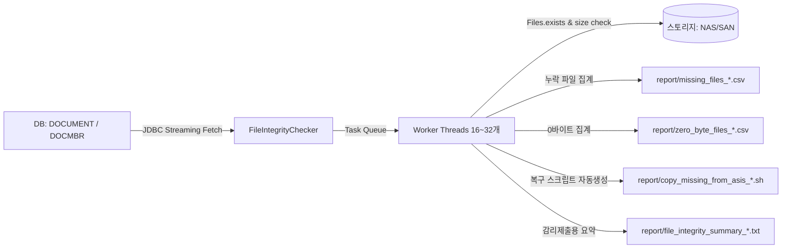
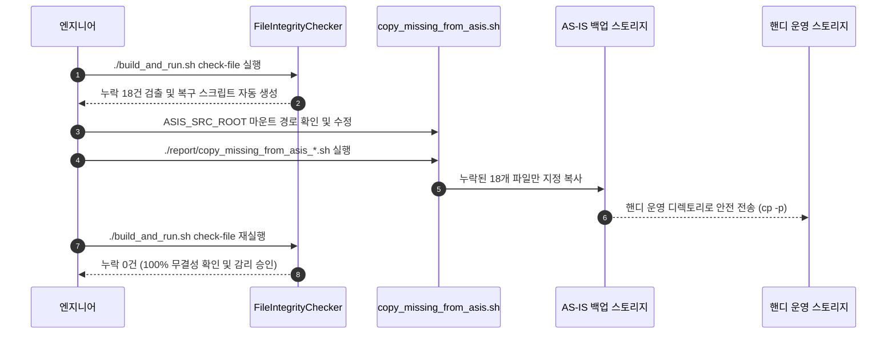

# 📁 전자결재 파일 물리 정합성 전수 점검 가이드 (FileIntegrityChecker)

> **프로젝트**: 한국보훈복지의료공단 차세대 전자결재(Handy 10.x, Tibero 7, Rocky Linux 9.7) 데이터 이관  
> **담당 에이전트**: Nexus (총괄), Forge (엔지니어링), Titan (스토리지/성능), Argus (품질/검증)  
> **최종 수정일시**: 2026-10-15  
> **대상 도구**: `com.handy.mig.FileIntegrityChecker` / `./build_and_run.sh check-file`

---

## 1. 개요 및 점검 배경

전자결재 데이터 마이그레이션에서 가장 빈번하게 사용자 불만을 유발하는 핵심 장애는 **"결재 문서는 열리는데 첨부파일 다운로드가 안 되거나 본문 파일이 깨져서 나오는 현상(404 Not Found)"**입니다.

이를 방지하기 위해 DB 메타데이터와 물리 스토리지(NAS/SAN) 간의 파일 정합성을 전수 검증하는 도구인 **`FileIntegrityChecker`**를 구축하였습니다.

### ❓ "디스크에는 있는데 DB에 없는 파일(반대의 경우)"도 점검해야 할까?
**결론: 오픈 점검 단계에서는 "굳이 하실 필요가 없습니다 (비권장)".**

* **케이스 A: DB(O), 디스크(X) → [누락 결손 파일] 🚨 치명적 (필수 검증 대상)**
  * 사용자가 문서 열람 시 즉시 시스템 에러("파일을 찾을 수 없습니다")가 발생합니다.
  * **오픈 전 반드시 0건(100% 무결성)으로 해결해야 하는 핵심 과제**입니다.
* **케이스 B: 디스크(O), DB(X) → [고아 잉여 파일] 🟢 무해함 (점검 불필요)**
  * 그룹웨어는 DB의 `DOCMBR` / `DOCUMENT` 테이블을 통해서만 파일을 호출하므로, DB에 없는 파일은 사용자가 접근하거나 호출할 일이 전혀 없습니다.
  * AS-IS 기안 취소 잔재, 임시파일, 또는 이번 프로젝트에서 적용한 **수신문서 첨부 중복 제외**로 인해 의도적으로 DB 매핑을 생략한 정상 미참조 파일들이 섞여 있습니다.
  * 수천만 개 NAS 파일을 풀 트래버설(`walkFileTree`)하는 것은 스토리지 I/O 낭비가 극심하므로, **스토리지 용량이 95% 이상 고갈되어 물리적 정리가 필요한 상황이 아니라면 점검하지 않는 것이 표준 실무 원칙**입니다.

### ❓ "002로 끝나는 HOX 결재정보 파일은 왜 점검에서 제외되나요?"
* **원리**: 핸디 그룹웨어에서 `002`로 끝나는 파일(`DOCUMENTTYPE = 2`, `결재정보.xml`, `*.hox`)은 **문서 열람(조회) 시 핸디 엔진이 DB 데이터를 읽어 실시간으로 자동 생성**합니다.
* **조치**: 물리 디스크에 파일이 없더라도 정상 동작하므로, 허위 누락 경보를 방지하기 위해 **기본적으로 점검 대상에서 자동 제외(SKIP)** 처리됩니다. (필요 시 `--include-hox` 옵션으로 포함 가능)

---ㄱ

## 2. 점검 도구 아키텍처 (`FileIntegrityChecker`)



### 주요 기술적 특장점
1. **대용량 초고속 멀티스레드 병렬 검증**:
   - `LinkedBlockingQueue` 기반 생산자-소비자 패턴 구축 (기본 16스레드, 초당 15,000~30,000건 파일 검증 속도).
2. **지능형 다중 경로 탐색 (Smart Path Resolver)**:
   - 핸디 표준 저장 규칙(`storage.base.path`, `sancbox`, 년/월/일 분할 폴더, 확장자 유무)을 순차 탐색하여 실제 저장 위치를 자동 매칭.
3. **품질 이상치(0바이트, 크기 불일치) 동시 탐지**:
   - 파일은 있으나 내용이 빈 `0 Byte` 파일 및 DB 기록 용량 대비 현저히 작은 손상 파일을 자동 분리.
4. **AS-IS 원천 선별 복구 쉘스크립트 자동 생성**:
   - 누락 파일이 발견되면, 전체를 다시 복사할 필요 없이 **누락된 파일만 AS-IS 원천 백업 디렉토리에서 뽑아 복사하는 실행 스크립트(`.sh`)를 즉시 생성**.

---

## 3. 실행 방법 (CLI)

모든 작업은 통합 실행 스크립트(`build_and_run.sh`)를 통해 간편하게 수행할 수 있습니다.

### ① 기본 실행 (운영 테이블 `INTRAWARE` 대상 전수 검증)
```bash
./build_and_run.sh check-file
```
> 기본값: `INTRAWARE.DOCUMENT` 및 `DOCMBR` 대상, 16 스레드 병렬 검증.

### ② 중간 이관 테이블(`MIG1_USER.MG_DOCUMENT`) 대상 사전 검증
```bash
./build_and_run.sh check-file --mig1
```
> 실제 운영 테이블 적재 전, 중간 테이블 단계에서 파일 복사가 잘 되었는지 사전 진단할 때 사용.

### ③ 고성능 튜닝 및 옵션 조합
```bash
# 32개 스레드로 고속 검증
./build_and_run.sh check-file --intraware --threads=32

# 샘플 10,000건만 신속 테스트
./build_and_run.sh check-file --limit=10000

# 파일 크기 불일치(Size Mismatch) 정밀 진단 포함
./build_and_run.sh check-file --check-size

# HOX 002 결재정보 파일도 강제로 점검 대상에 포함할 경우 (기본값: 자동 제외)
./build_and_run.sh check-file --include-hox
```

---

## 4. 산출물 및 리포트 분석

점검이 완료되면 `handy_mig/report/` 디렉토리에 타임스탬프 기반 산출물이 생성됩니다.

| 산출물 파일명 | 포맷 | 내용 및 활용 용도 |
| :--- | :---: | :--- |
| **`missing_files_YYYYMMDD_HHMMSS.csv`** | CSV (BOM) | **누락(404) 파일 상세 목록**<br>(결재ID, OBJECTID, 파일명, DB크기, 예상경로, 결손사유) |
| **`zero_byte_files_YYYYMMDD_HHMMSS.csv`** | CSV (BOM) | **0바이트 불완전 파일 목록**<br>(파일은 있으나 내용이 0바이트로 깨진 파일) |
| **`copy_missing_from_asis_YYYYMMDD_HHMMSS.sh`** | Bash Script | **누락 파일만 AS-IS 원천에서 선별 복사하는 복구 스크립트** |
| **`file_integrity_summary_YYYYMMDD_HHMMSS.txt`** | Text | **감리/검수 제출용 종합 요약 통계 리포트** |

### 요약 보고서 예시 (`file_integrity_summary_*.txt`)
```text
====================================================================================
 [Handy MIG] 전자결재 파일 물리 정합성 전수 점검 종합 보고서
====================================================================================
점검 일시         : 2026-10-15 13:15:20
점검 대상 스키마 : INTRAWARE
스토리지 베이스   : /data
총 검사 건수      : 5,600,228 건
정상 존재 파일    : 5,600,210 건 (99.99%)
누락 결손 파일    : 18 건 (0.01%)
0바이트 파일     : 0 건
크기 불일치 파일 : 0 건
누락 총 추정용량  : 42.15 MB (약 0.04 GB)
총 검사 소요시간  : 185.40 초 (평균 30,206 건/초)
====================================================================================
[품질 판정]
 -> [보완 필요 / ACTION REQUIRED] : 18 건의 누락 파일이 확인되었습니다.
    누락 리포트(missing_files_*.csv) 및 자동생성 복구 스크립트(copy_missing_from_asis_*.sh)를 활용하여
    AS-IS 원천 스토리지에서 즉시 보완 복사를 수행하십시오.
====================================================================================
```

---

## 5. 누락 파일 발생 시 후속 조치 표준 절차 (SOP)

누락 파일(`missing_files_*.csv`)이 발생한 경우 다음 절차에 따라 신속히 조치합니다.



### STEP 1. 원천 선별 복구 스크립트 환경변수 확인
자동 생성된 `report/copy_missing_from_asis_*.sh` 상단의 원천 경로를 확인합니다.
```bash
vi report/copy_missing_from_asis_*.sh

# 아래 경로를 실제 원천 백업 마운트 경로로 지정
ASIS_SRC_ROOT="/backup/asis_storage"
TOBE_TARGET_ROOT="/data"
```

### STEP 2. 선별 복구 실행
```bash
chmod +x report/copy_missing_from_asis_*.sh
./report/copy_missing_from_asis_*.sh
```

### STEP 3. AS-IS 원천에도 없는 영구 유실 파일의 처리 기준
만약 AS-IS 원천 서버 자체에서도 이미 삭제되어 복구가 불가능한 파일인 경우:
1. **대체 안내 파일(Placeholder) 배치**:
   - "원천 시스템에서 이미 유실된 파일입니다" 내용의 텍스트/안내문 파일을 해당 OBJECTID 경로에 배치하여 사용자 화면 404 에러 방지.
2. **사유서 및 감리 증빙 기록**:
   - `missing_files_*.csv`의 사유 컬럼에 `AS-IS 원천 스토리지 미존재 확인` 기록 후 감리단에 공식 보고.

### STEP 4. 재검증 수행
```bash
./build_and_run.sh check-file
```
* 최종 리포트에서 `누락 결손 파일: 0 건 (100.00%)` 확인 후 검증 작업을 최종 완료합니다.
